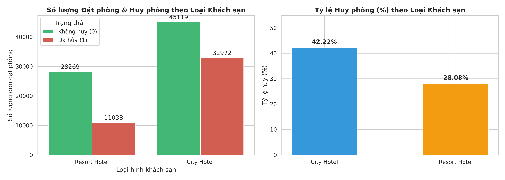
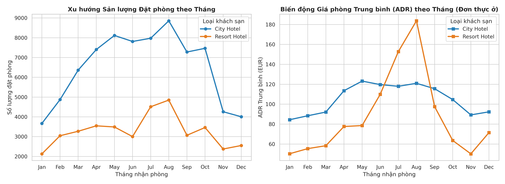
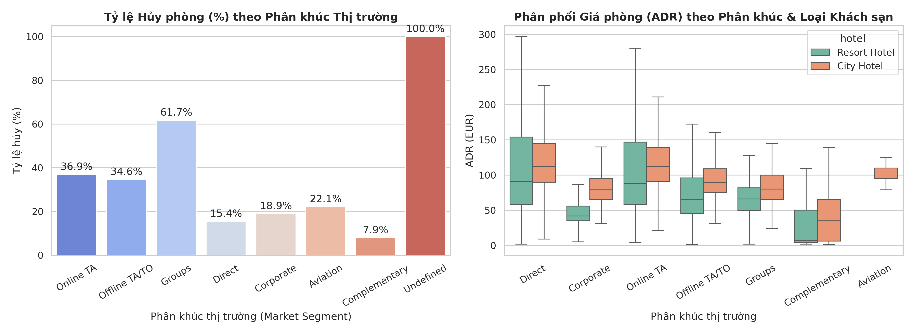
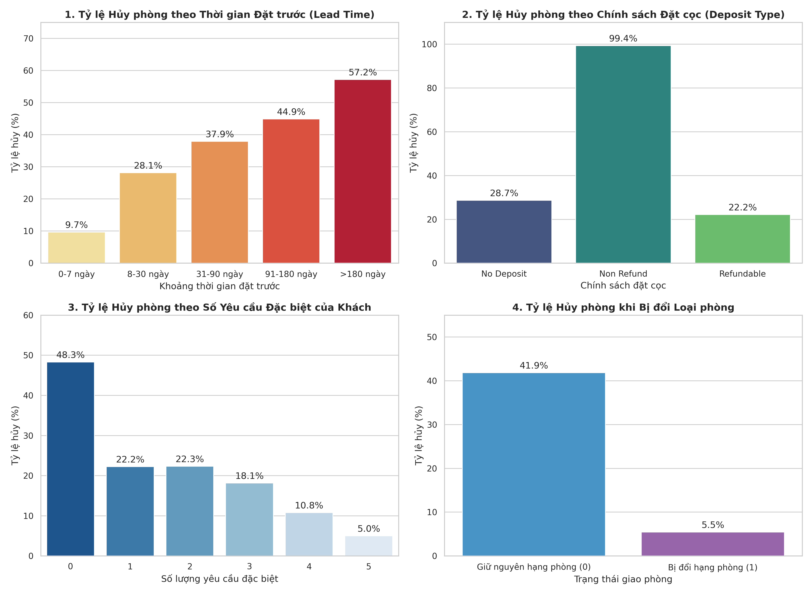
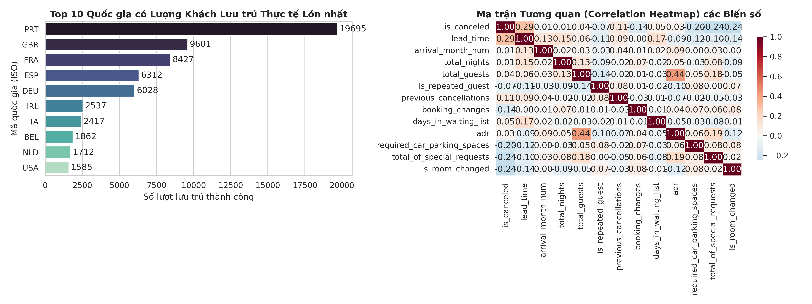
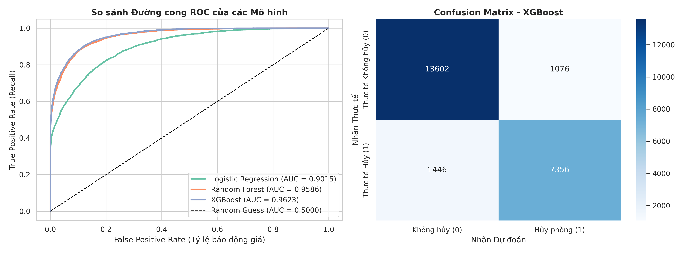
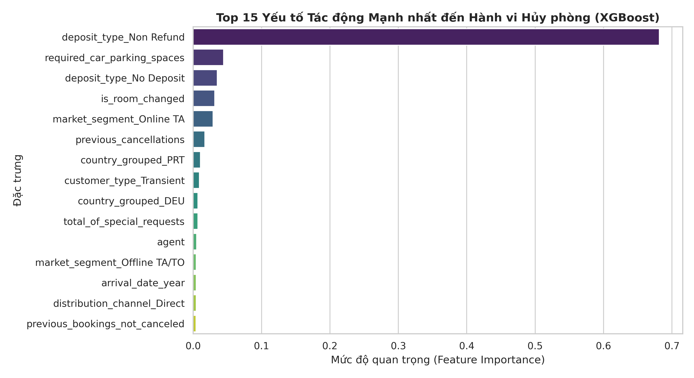
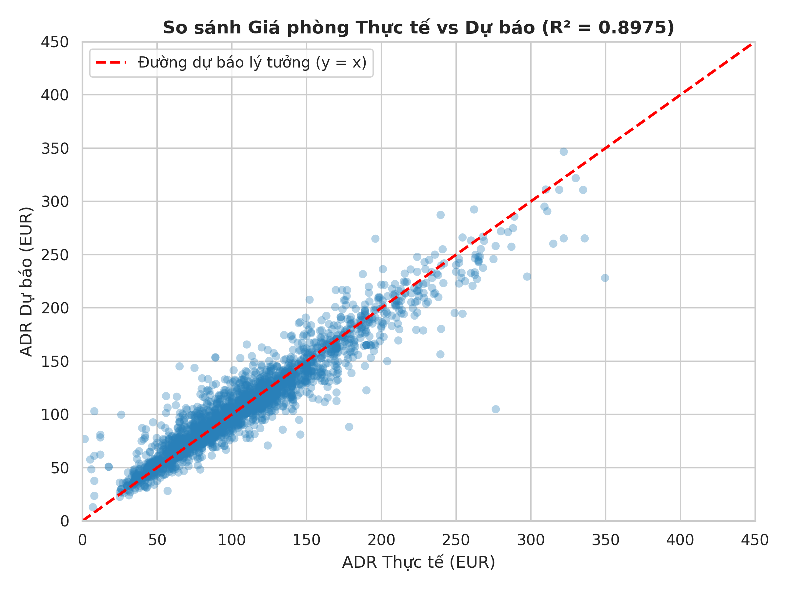

# 🏨 Hotel Booking Demand: Phân Tích Nhu Cầu, Dự Đoán Hủy Phòng & Giá Phòng (ADR)

> **Đề tài 08 (ĐT08)** — Học phần: *Chuyên đề chuyên sâu Kỹ thuật CNTT 1*  
> **Trường:** Đại học Nguyễn Tất Thành — Khoa Công nghệ Thông tin  
> **Sinh viên thực hiện:** *Nguyễn Trung Kiên-Trương Phạm Đăng Khoa-Lê Anh Khoa*  
> **Giảng viên hướng dẫn:** *ThS. Phạm Mạnh Trung Nguyên*

---

## 📌 1. Tổng Quan Dự Án

Dự án thực hiện quy trình khoa học dữ liệu hoàn chỉnh (End-to-End Machine Learning Pipeline) trên bộ dữ liệu **Hotel Booking Demand** nhằm giải quyết đồng thời hai bài toán kinh doanh cốt lõi trong ngành khách sạn:

1. **Bài toán Phân loại (Classification):** Dự đoán khả năng một đơn đặt phòng bị hủy (`is_canceled`) giúp khách sạn chủ động chính sách đặt cọc và tối ưu công suất phòng.
2. **Bài toán Hồi quy (Regression):** Dự đoán mức giá trung bình mỗi đêm — **ADR (Average Daily Rate)** phục vụ chiến lược định giá linh hoạt theo mùa vụ và phân khúc khách hàng.

---

## 📂 2. Cấu Trúc Thư Mục

```text
Hotel-Booking-Demand-ML/
├── data_raw/
│   └── hotel_bookings.csv                     # Dữ liệu gốc ban đầu
├── data_clean/
│   └── hotel_bookings_clean.csv               # Dữ liệu sau khi làm sạch & tiền xử lý
├── outputs/
│   ├── 01_hotel_cancellation_overview.png     # Tổng quan tỷ lệ hủy phòng theo loại khách sạn
│   ├── 02_monthly_demand_and_adr.png          # Biến động nhu cầu đặt phòng & giá ADR theo tháng
│   ├── 03_market_segment_analysis.png         # Phân tích theo phân khúc thị trường
│   ├── 04_cancellation_drivers.png            # Các yếu tố tác động mạnh đến việc hủy phòng
│   ├── 05_countries_and_correlation.png       # Phân bố quốc gia & ma trận tương quan
│   ├── 06_roc_and_confusion_matrix.png        # Đường cong ROC-AUC & Ma trận nhầm lẫn
│   ├── 07_top15_feature_importance.png        # Top 15 đặc trưng quan trọng nhất
│   ├── 08_adr_actual_vs_predicted.png         # Đối chiếu giá ADR thực tế vs. dự đoán
│   ├── best_cancellation_pipeline.joblib      # Mô hình pipeline dự đoán hủy phòng tốt nhất
│   └── best_adr_pipeline.joblib               # Mô hình pipeline dự đoán giá ADR tốt nhất
├── TT/                                        # Tài liệu / báo cáo liên quan
├── DT08_Hotel_Booking_Demand_Cancellation_Pipeline.ipynb  # Notebook thực nghiệm chính
├── .gitignore
└── README.md
```

---

## 🔬 3. Quy Trình Thực Hiện

1. **Thu thập & Làm sạch dữ liệu (`data_raw` → `data_clean`):**
   * Xử lý giá trị khuyết thiếu (missing values), loại bỏ bản ghi trùng lặp và ngoại lai bất thường (như giá ADR âm hoặc đơn đặt phòng không có khách).
   * Chuẩn hóa kiểu dữ liệu và tạo các đặc trưng mới (Feature Engineering).
2. **Phân tích Khám phá Dữ liệu (EDA):**
   * So sánh hành vi đặt/hủy phòng giữa City Hotel và Resort Hotel.
   * Phân tích tính mùa vụ theo tháng, kênh phân phối (Market Segment), quốc gia khách hàng và các yếu tố kéo tăng tỷ lệ hủy phòng (thời gian đặt trước, tiền cọc, lịch sử hủy).
3. **Xây dựng & Đánh giá Mô hình Machine Learning:**
   * **Pipeline Dự đoán Hủy phòng:** Huấn luyện, tối ưu và lưu mô hình tốt nhất vào `outputs/best_cancellation_pipeline.joblib`; đánh giá qua Accuracy, Precision, Recall, F1-Score, ROC-AUC và Confusion Matrix.
   * **Pipeline Dự đoán Giá ADR:** Huấn luyện, tối ưu và lưu mô hình tốt nhất vào `outputs/best_adr_pipeline.joblib`; đánh giá qua MAE, RMSE và $R^2$.

---

## 📊 4. Kết Quả Trực Quan Hóa Nổi Bật

### Phân tích dữ liệu khám phá (EDA)
| Tổng quan tỷ lệ hủy phòng | Nhu cầu & Giá ADR theo tháng |
| :---: | :---: |
|  |  |

| Phân khúc thị trường | Các yếu tố thúc đẩy hủy phòng |
| :---: | :---: |
|  |  |



### Đánh giá hiệu năng mô hình
| ROC-AUC & Confusion Matrix (Hủy phòng) | Top 15 đặc trưng quan trọng |
| :---: | :---: |
|  |  |



---

## 🚀 5. Hướng Dẫn Chạy Dự Án & Tải Mô Hình

### Cài đặt thư viện cần thiết
```bash
pip install pandas numpy matplotlib seaborn scikit-learn joblib jupyter
```

### Chạy Notebook thực nghiệm
Mở file `DT08_Hotel_Booking_Demand_Cancellation_Pipeline.ipynb` bằng **PyCharm**, **VS Code** hoặc **Jupyter Notebook** và chạy lần lượt các cell.

### Tải lại mô hình đã huấn luyện bằng `joblib`
```python
import joblib

# Tải pipeline dự đoán hủy phòng
cancel_model = joblib.load("outputs/best_cancellation_pipeline.joblib")

# Tải pipeline dự đoán giá phòng trung bình (ADR)
adr_model = joblib.load("outputs/best_adr_pipeline.joblib")
```

---

## 🛠️ Công Nghệ Sử Dụng
* **Ngôn ngữ:** Python
* **Xử lý & Trực quan hóa dữ liệu:** Pandas, NumPy, Matplotlib, Seaborn
* **Machine Learning & Đóng gói:** Scikit-learn, Joblib, Jupyter Notebook